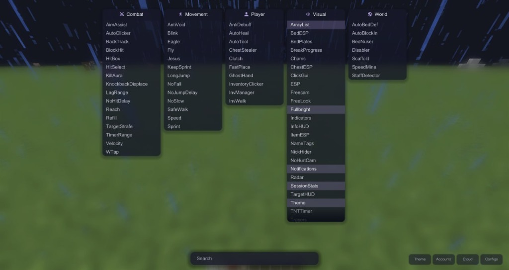

# OpenMyauValor

<p align="center">
  
</p>

"Valor Client" but for free. Egotistical owner always criticising other clients, rude to his own buyers, lies that it isn't AI or skidded. 

Here is the full deobfed crap they give you for the price of a Big Mac. 

# Reality

The entire client is literally just an OpenMyau paste with public GitHub bypasses pasted word for word. If you have browsed any public 1.8.9 repo or another deobf then you've probably seen their bypasses already. And the visuals look like they were made by a blindfolded AI.

## Auth Overview

- Their entire backend is hosted on a free Vercel hobby tier. Spending zero dollars on hosting for a paid product.
- Their site has multiple endpoints that crash with minimal effort and casually leaks session tokens in plain responses.
- They drop a physical jar into your temp folder to inject and never delete it. It fills up your storage eventually.
- Authentication relies on a single boolean check. That is the entire wall protecting their product.
- The jar was packed with free Proguard and a dream.
- Their encryption key was so weak it was pulled out of the binary in less than five minutes.

## Custom Injector

Instead of dealing with their broken auth servers or whatever loader they hand out, I wrote a custom injector and open sourced it alongside the client. 

You do not need their website, you do not need their permission, and you definitely do not need to pay them. Just inject and enjoy OpenMyauValor.

## Build

To compile the client yourself, make sure you have JDK 17 installed for Gradle and run:

```bash
./gradlew build
```

This builds everything into a single JAR at:

`build/libs/valor-1.0.0-universal.jar`

### Universal JAR

The JAR includes both the Valor client and its injector, so you don't need a separate launcher or script.

- **Built-in injector:** Double-click the JAR or run `java -jar valor-1.0.0-universal.jar` to open the injector.
- **Multiple client support:** Detects the running Minecraft instance and uses the appropriate mappings for Forge 1.8.9, Vanilla, Badlion Client, or Lunar Client.
- **Native injector:** Includes `valor_injector.dll` as an alternative when JVM attach isn't available.

### How to use

1. Launch Minecraft 1.8.9 using Forge, Lunar, Badlion, or Vanilla.
2. Run `valor-1.0.0-universal.jar`.
3. Select your Minecraft instance from the list.
4. Click **Inject Open Valor** and you're good to go.

Everything is included in one JAR, so there's no need to download or set up anything separately.

## Credits

Massive respect to the actual developer of the base they decided to skid:
- **60124808866** - Original creator and developer of OpenMyau

And credit to the skid devs:
- **qloha** & **dot19kz** - Developers of Valor (the paid OpenMyau fork / skid)

## Final Note

OpenMyau fork, vercel free tier infrastructure, proguard obfuscation & a dream, weak encryption key, 1% auth 99% junk, bunch of crash exploits on site, leaks your session token, visuals made by blindfolded AI and egotistical owner. Good price for 14$ I guess?

PS. the jar's project folder was literally named "OpenMyau" with qloha's PC username on it, "Begly"... LOL

